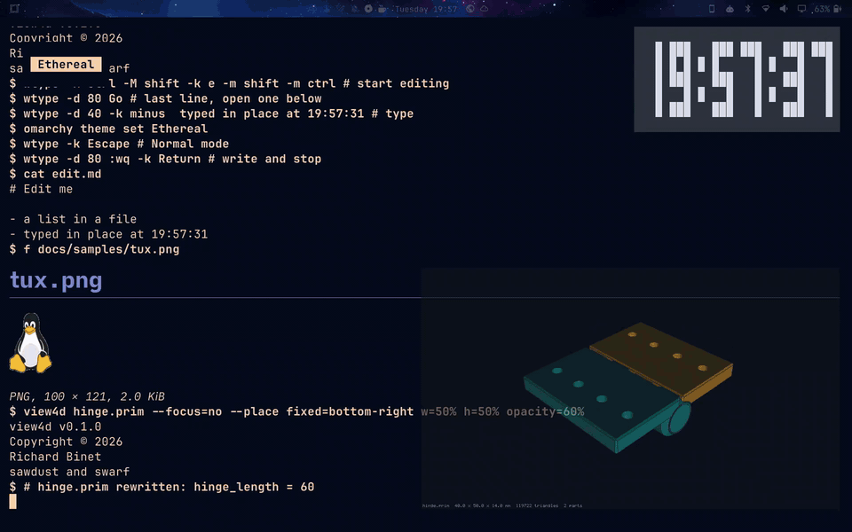

# termmd

> [!CAUTION]
> **All the code in this repository was generated by Claude, an AI from Anthropic, and has not been checked by a person.** It may have bugs or not do what it says. Read it before you rely on it, and use it at your own risk.

A GPU-accelerated terminal emulator for Linux and Wayland, made for [Omarchy](https://omarchy.org) but not tied to it. On top of being a terminal it:

- renders Markdown in place (`f FILE.md` shows a file and follows changes to it), with styling you can change,
- shows images,
- edits blocks of text with vi keys,
- scrolls easily through history,
- hosts **embedded apps**: programs that draw their own live pane in the terminal over a socket ([docs/SURFACE.md](docs/SURFACE.md)). [view4d](https://github.com/sawdustandswarf/view4d) (3D scenes) and [specan](https://github.com/sawdustandswarf/specan) (a spectrum analyser) are two.

[](docs/media/tour.mp4)

*The tour, [`demos/tour.sh`](demos/tour.sh): an animated PNG, which plays on GitHub and shows its first frame in termmd ([full-quality video](docs/media/tour.mp4)).*

It is written almost entirely from scratch, with **zero third-party crates**: the Wayland client, XKB keymaps, the VT engine, the font rasterizer and shaping, PNG and DEFLATE, TOML and D-Bus are all here. It links only libc and the Vulkan loader.

Status: a hobby project. Linux and Wayland only for now. See [docs/PLAN.md](docs/PLAN.md) for what is done and what is next.

## Build and run

Needs a stable Rust toolchain (`rust-toolchain.toml` picks it), a Vulkan driver and a Wayland compositor.

```sh
cargo build --release
./target/release/termmd
```

Generated code (Wayland protocols, Unicode tables, keysyms, SPIR-V shaders) is committed, so a normal build needs no generator step. To regenerate it, run `cargo xtask` (shaders also need `glslc`).

### Install

```sh
install -Dm755 target/release/termmd ~/.local/bin/termmd
install -Dm644 dist/termmd.desktop ~/.local/share/applications/termmd.desktop
install -Dm755 dist/f ~/.local/bin/f         # optional helpers in dist/: f (show a file), lsmd (ls as a
                                             # Markdown table), clock, termmd-crashes (crash reports)
```

On Omarchy, copy `dist/omarchy/*.tpl` to `~/.config/omarchy/themed/` so termmd follows theme switches. See [docs/OMARCHY.md](docs/OMARCHY.md).

## Demos

`demos/tour.sh`, run inside termmd (recorded at the top of this page), is a tour of five 4-second scenes (`SCENE`) that prints every call it makes: the Markdown cheat sheet laid out deliberately slowly; a document followed while it is rewritten; a file edited in place, with the keys typed by `wtype` (only while the window has the focus); an image; and `lsmd`. Meanwhile embedded-app demos run in the bottom right one after another (the last two faded and under the text), the clock (`dist/clock`) shows the time in the top right, and the Omarchy theme changes every 5 seconds (`demos/theme.sh` as a subtask), back to yours at the end. With no arguments it runs the `demos/*.sh` of any repositories cloned beside this one (view4d's and specan's have some), or give it the scripts to run. A demo is a script that prints the command it runs, starts one app in a pane of the termmd it runs in, in the background, and returns; `PLACE` gives it its placement keys and `DURATION` stops it after that many seconds.

`demos/theme.sh` changes the Omarchy theme, which termmd follows live: `demos/theme.sh Nord` switches to one, `demos/theme.sh Nord Gruvbox "Tokyo Night"` (or `--all`) steps through several, one every 5 seconds (`-s` to change), `--loop` round and round until stopped, naming each over the top left, and then goes back to the theme you had.

## Configuration

The settings file is `~/.config/termmd/termmd.toml`, and Markdown styling goes in `~/.config/termmd/markdown.toml` (`dist/markdown.toml` is a commented starting point). Both reload live. Every key binding is listed in [docs/KEYS.md](docs/KEYS.md).

## Documentation

| | |
|---|---|
| [docs/DESIGN.md](docs/DESIGN.md) | architecture: workspace, event loop, Wayland, XKB, rendering |
| [docs/KEYS.md](docs/KEYS.md) | modes and key bindings |
| [docs/MARKDOWN.md](docs/MARKDOWN.md) | Markdown rendering and styling |
| [docs/SURFACE.md](docs/SURFACE.md) | the embedded-app protocol |
| [docs/OMARCHY.md](docs/OMARCHY.md) | Omarchy integration |
| [docs/GLOSSARY.md](docs/GLOSSARY.md) | the words used throughout |
| [docs/PLAN.md](docs/PLAN.md), [docs/TASKS.md](docs/TASKS.md) | progress and deferred design work |

## Hardware

Designed and optimised for my laptop, a **Lenovo ThinkPad T14 Gen 3**: 12th Gen Intel Core i7-1255U, Intel integrated graphics (Alder Lake), 16 GB of memory and a 1920 × 1200 screen at 1.5× scale, running [Omarchy](https://omarchy.org) (Arch Linux and Hyprland). Other machines may well work, but they haven't been tried.

## Contributing

Issues and pull requests are welcome: see [CONTRIBUTING.md](https://github.com/sawdustandswarf/.github/blob/main/CONTRIBUTING.md).

## License

MIT, see [LICENSE](LICENSE). Use it for anything; it comes with no warranty.

Third-party data kept under its own terms: `data/unicode/` (Unicode Character Database, Unicode License v3), `data/xkbcommon-keysyms.h` (from xkbcommon, MIT/X11-style, see its header), and `protocols/*.xml` (Wayland protocols, each with the copyright and license in its header).
